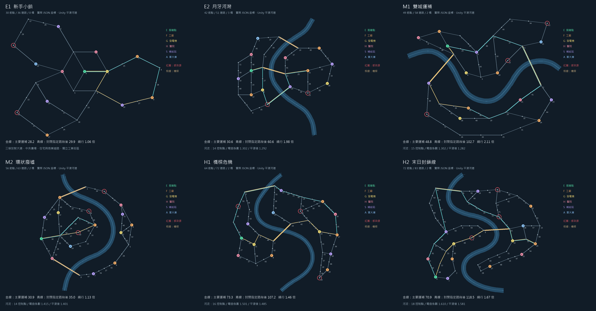

# Apocalypse_map

《末日大逃殺》的六張合作撤離地圖，分為簡單、中等和困難三種難度。每張地圖都有不同的街區、運補路線和感染風險，適合用來練習修復發電機、運送零件、救援與撤離。



## 地圖

| 難度 | 地圖 | 特色 |
|---|---|---|
| 簡單 | [新手小鎮](maps/E1_town.json)・[預覽](previews/E1_town.png) | 中央廣場與放射道路，適合熟悉基本運輸和救援。 |
| 簡單 | [月牙河灣](maps/E2_river_town.json)・[預覽](previews/E2_river_town.png) | C 形河灣、半島和三座橋，練習跨河運輸。 |
| 中等 | [雙城運補](maps/M1_dual_city.json)・[預覽](previews/M1_dual_city.png) | 蛇行河道分隔老城與工業區，需要跨岸分工。 |
| 中等 | [環狀廢墟](maps/M2_ruins.json)・[預覽](previews/M2_ruins.png) | 外環與感染區內的中央捷徑，考驗風險和繞路取捨。 |
| 困難 | [橋樑危機](maps/H1_bridge_crisis.json)・[預覽](previews/H1_bridge_crisis.png) | S 形河谷隔開主要資源與撤離點；主橋封鎖時須繞往遠端備橋。 |
| 困難 | [末日封鎖線](maps/H2_final_escape.json)・[預覽](previews/H2_final_escape.png) | 複雜河灣、半島與遠端工業區，需要更仔細的路線規劃與醫療管理。 |

預覽中的金線與青線分別顯示範例運補路線及指定道路封鎖後的替代路線；紅圈表示初始感染點。

## 安裝與切換

本儲存庫提供地圖資料，需要搭配**支援自訂地圖**的《末日大逃殺》版本使用。

1. 下載本儲存庫，將 `maps/` 中需要的 JSON 複製到遊戲的 `Apocalypse_Data/StreamingAssets/maps/`。若使用 Unity 專案，複製到 `game/unity/Assets/StreamingAssets/maps/`。
2. 啟動遊戲時使用 `-map` 指定地圖，例如：

   ```powershell
   .\Apocalypse.exe -map E1_town.json
   ```

   將檔名換成其他地圖即可切換；也可以傳入 JSON 的完整路徑。

3. 或在遊戲的 `StreamingAssets/config.json` 中設定，例如 `"mapFile": "E1_town.json"`。

遊戲找不到地圖或地圖驗證失敗時會回退為隨機地圖；請查看遊戲日誌，確認出現「使用自訂地圖」訊息。部分較舊的建置不支援 `-map`。

## 驗證與測試

六張地圖曾使用 Unity 的 `CityMap.Validate()` 和自訂地圖載入流程檢查，並檢查道路、橋樑、供電分區及替代路線。每張地圖也以相同八人設定在 SDK 本機模擬器執行五個種子：E1、E2、M1、M2、H1 均為 5/5 場有人撤離，H2 為 4/5。

模擬不保證所有策略或隨機種子都能通關；完整 3D 多人場次與真人平衡仍需實際遊玩測試。
